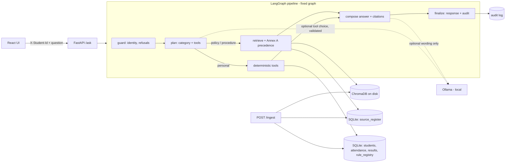

# uniAssist - evidence-first university student-services assistant

Answers student questions from **authorised university documents** and **authorised student records**, and never
invents a rule, a number or a decision.

* Policy and procedure questions -> retrieved passages with **document, section, page, version and effective date**.
* Personal questions ("what is my attendance", "am I eligible...") -> **deterministic tools** over SQLite; thresholds
  are read from a **rule registry** where every rule cites a document clause.
* Conflicting or versioned documents -> resolved by the **Source Precedence Policy (Annex A)**, with the reasoning shown;
  unresolvable conflicts are **flagged, not guessed**.
* Every response carries a `trace_id` and an **audit record** (sources, tools with inputs/outputs, rules, conflicts,
  model, tokens, latency).

> **Before you submit - three things only your team can supply** (details in "Deliverables status" below):
> 1. the **real, official university documents** (>= 3; the bundled corpus is synthetic fixtures for tests/evaluation),
> 2. the **team contribution statement** and **signed declarations** (templates in `docs/`),
> 3. a **git tag** (`git tag -a final -m "final"`) after committing.

## Architecture



### Design decisions (and what we deliberately did not build)

* **A fixed LangGraph, not a supervisor with specialist agents.** Every step is either deterministic (guard,
  retrieval, precedence, tools, composition) or one validated LLM call (planning, explanation). There is no step where
  autonomous multi-agent behaviour would add accuracy, and a fixed graph is fully auditable. The graph still has real
  branching (refuse / clarify / retrieve / tools).
* **The LLM never decides anything authoritative.** It may *choose tools* (output validated against the tool registry,
  fallback to a deterministic planner) and *word an explanation* (every number must already appear in the evidence it was
  shown, else the deterministic text is used). Calculations, eligibility and student-data lookups are code over SQLite.
* **Rules live in the database, not in code.** `rule_registry` rows are extracted from ingested documents (or added
  explicitly) and each cites `source_doc_id` + `source_section`. `tests/test_tools.py::test_rule_thresholds_are_not_hard_coded`
  proves a registry edit flips a decision.
* **Retrieval and tools share one precedence engine** (`rag/precedence.py`), so a retrieved answer and a tool decision
  cannot disagree about which document wins. Retrieval also pulls in *every* source that makes a claim on the same
  topic, not only the ones that scored well, so a FAQ that matches the wording ("65%") cannot hide the circular that
  overrides it.
* **Embedded ChromaDB persisted to `runtime/chroma`** (not a separate server): one fewer container, restarts never
  re-ingest. Embeddings: `BAAI/bge-small-en-v1.5` (best of the two allowed models on our evaluation, see below).
* **Section-aware chunking** (clause boundaries, page and section kept as metadata) so citations point at the exact
  clause; fixed-size chunking scored 3.7 % citation accuracy in our comparison.
* **Privacy (R7/R10).** The student's identity comes only from `X-Student-Id`. The audit log stores the student id, the
  tools called with their inputs/outputs (required by R10) and the answer type, but **not the question text** (only a
  short hash); no student data goes to any external service (Chroma telemetry is disabled, the LLM is local).
* **Not built:** a cloud-LLM fallback (none is used anywhere, nothing leaves the machine), user authentication (the
  identity is whatever `X-Student-Id` the trusted caller sets, as the contract specifies), re-ranking models.

## Quick start

### Docker (API + UI start together)

```bash
docker compose up --build        # API http://localhost:8000/docs   UI http://localhost:5173
```

First boot loads the synthetic students and ingests `corpus/source_register.csv` (~30 s, embeddings are baked into the
image). State persists in `./runtime` (vectors, SQLite, audit log, uploaded originals); restarts do **not** re-ingest.

**Ollama on the host** (optional; `LLM_MODE=mock` works without it):

```bash
ollama pull llama3.1:8b                                  # or qwen2.5:7b-instruct
LLM_MODE=ollama docker compose up --build                # backend reaches the host at host.docker.internal:11434
# Linux: host.docker.internal is mapped via extra_hosts. If Ollama listens only on localhost, run: OLLAMA_HOST=0.0.0.0 ollama serve
```

### Local (Python 3.11+, Node 20+)

```bash
python -m venv .venv && source .venv/bin/activate        # Windows: .venv\Scripts\Activate.ps1
pip install -r requirements.txt                          # tesseract is optional (OCR of scanned pages)
python scripts/bootstrap.py                              # schema + synthetic students + corpus (idempotent)
uvicorn app.api.main:app --port 8000                     # the API also bootstraps on start unless AUTO_BOOTSTRAP=0
cd frontend && npm install && npm run dev                # http://localhost:5173 (proxies /api to :8000)
```

`MOCK`/`ollama`: set `LLM_MODE` (`mock` default) and `LOCAL_LLM_MODEL` / `LOCAL_LLM_BASE_URL` (see `.env.example`).
**Cloud LLM: none.** There is no cloud fallback in this code base; student data never leaves the machine.

## API (fixed contract)

| Endpoint | Purpose |
|---|---|
| `POST /ask` | Body `{"question", "as_of_date"?}`, header `X-Student-Id` (optional for general questions) |
| `POST /ingest` | Multipart: `file` + `metadata` (Annex B fields as JSON, or as form fields). Returns `doc_id`, `chunks_indexed`, `status` |
| `GET /health` | Status of API, SQLite, vector store, LLM |
| `GET /audit/{trace_id}` | Full audit record of one response |
| `GET /sources` | Source Register (all ingested documents) |
| `POST /admin/students` | Test-student loader (CSV files in the Annex C schema); CLI twin: `scripts/load_students.py` |

Answer types: `retrieved_fact`, `calculated`, `not_found`, `clarification_needed`, `refused`, `conflict_flagged`.
Interactive docs: `http://localhost:8000/docs`.

### Sample requests (real output, trimmed)

```bash
# 1. General policy question: the 80% circular supersedes the 75% regulation clause; the 65% FAQ is ignored
curl -s -X POST localhost:8000/ask -H 'Content-Type: application/json' \
  -d '{"question":"What is the minimum attendance required to appear for end-semester exams?","as_of_date":"2026-10-06"}'
# -> answer_type "retrieved_fact": "With effect from 1 August 2026, the minimum attendance ... shall be 80% in each course.
#    (Source: Circular ACAD/2026/08 ..., section 1.1, page 1, version 1.0, effective 2026-08-01.)
#    Upcoming change (not yet in force): FIX-CIR-2027-01 takes effect on 2027-01-01: ... 85% ..."
#    explanation: "...Explicit supersession (step 2): FIX-CIR-2026-08 (level 2) supersedes FIX-REG-2024 clause 7.2 ...
#                  Authority (step 3): FIX-FAQ-2026 (level 4) says min_attendance_pct=65, but FIX-CIR-2026-08 (level 2) prevails."

# 2. Personal eligibility: computed by a tool, thresholds from the rule registry, cited to the clause
curl -s -X POST localhost:8000/ask -H 'Content-Type: application/json' -H 'X-Student-Id: S1001' \
  -d '{"question":"Am I eligible to appear in the exam for Data Structures?","as_of_date":"2026-10-06"}'
# -> "calculated": "You are not eligible ... Data Structures (CS201)."  tools_invoked: check_exam_eligibility ->
#    attendance_pct 75.0, required_pct 80.0, classes_short 2, applied_rules: R-FIX-CIR-2026-08-min_attendance_pct-1.1 (>=80%)
#    The same question with "as_of_date":"2026-05-01" answers ELIGIBLE under the 75% regulation.

# 3. Multi-step what-if, assumptions stated
curl -s -X POST localhost:8000/ask -H 'Content-Type: application/json' -H 'X-Student-Id: S1003' \
  -d '{"question":"I failed Data Structures. If I pass the supplementary, will I be eligible for placement?"}'
# -> "If you pass the supplementary in CS201: you would be eligible for campus placement."
#    assumptions: ["Passing the supplementary clears the backlog in CS201: active backlogs 1 -> 0.", "CGPA stays at 6.9 ..."]

# 4. Not answerable / another student / no identity
curl -s -X POST localhost:8000/ask -H 'Content-Type: application/json' -d '{"question":"What is the scholarship for studying in Antarctica?"}'
#    -> not_found: "I could not find this information in the authorised university sources."
curl -s -X POST localhost:8000/ask -H 'Content-Type: application/json' -H 'X-Student-Id: S1001' -d '{"question":"What is the attendance of S1002?"}'
#    -> refused (identity comes only from the header; no tool is called)

# 5. Live ingestion: a new circular is used by the very next question, no restart
curl -s -X POST localhost:8000/ingest -F file=@circular.pdf -F 'metadata={"doc_id":"ACAD-2026-11","title":"Circular ACAD/2026/11",
  "issuer":"Office of the Dean (Academics)","authority_level":2,"doc_type":"circular","version":"1.0","effective_from":"2026-10-05",
  "supersedes":"FIX-CIR-2026-08#1.1","scope_programmes":"ALL","scope_batches":"ALL","provenance":"https://...","retrieved_on":"2026-10-06","synthetic":"N"}'
# -> {"doc_id":"ACAD-2026-11","chunks_indexed":2,"status":"ingested","rules_extracted":1,"rules":[{"parameter":"min_attendance_pct","operator":">=","value":"85","section":"1.1",...}],"warnings":[]}

# 6. Audit and sources
curl -s localhost:8000/audit/<trace_id>        curl -s localhost:8000/sources        curl -s localhost:8000/health
```

Three complete sample audit records (plus request and response) are in `docs/sample_audit/`:
`calculated_personal_eligibility.json`, `conflict_flagged.json`, `not_found.json` (and three more types).

## Documents, versions and precedence

* **Source Register** = SQLite table `source_register` (Annex B fields) plus `corpus/source_register.csv` (the seed list
  for first boot). `POST /ingest` takes the same fields as metadata. `effective_from` and `authority_level` are required;
  `effective_to`, `supersedes` (`DOC-ID` or `DOC-ID#7.2`, `;`-separated), `scope_programmes`, `scope_batches`
  (`ALL`, `2023`, `2023+`, `2021-2023`, `;`-lists) are optional.
* **Parsing**: PDF text by page, tables kept as rows, section numbers (`7.2`) detected as clause labels, **OCR fallback
  (tesseract) for scanned pages**, line-wrap repair, instruction-like sentences inside documents are **removed and
  flagged** (`R8`: documents are data, not instructions).
* **Precedence (Annex A)**, `rag/precedence.py`: (1) applicability - date window and programme/batch scope; documents
  not yet effective are excluded and reported as *upcoming changes*; (2) explicit supersession by a level 1-2 document;
  (3) higher authority; (4) later `effective_from`; (5) otherwise `conflict_flagged` with both sources cited.
  Level 5 (unofficial) text is informational only. Authority and recency are applied only between sources that make
  *different claims on the same topic*; complementary passages are all kept.
* **How a rule gets into the registry** (`ingestion/service.py`, `rag/claims.py`): on ingest, deterministic extractors
  find comparable claims (minimum attendance, pass mark, placement CGPA and backlog limits, who may take the
  supplementary exam) and write `rule_registry` rows citing the document and clause; administrators can also pass
  explicit `rules` in the metadata. **When a new circular changes a rule**: ingest it with `supersedes`/`effective_from`;
  it adds a competing rule row, the precedence engine picks the winner for each `as_of_date`, and old rows are kept so
  past dates still answer correctly. Re-ingesting a changed file replaces only that document's rules.

### Real documents (action required)

The repository ships **synthetic fixture documents** (`corpus/fixtures/`, built by `scripts/build_fixtures.py`) so
that conflicts, supersession, upcoming changes, scope, tables, OCR and prompt-injection are testable. They are not
official. To use your university's documents (the guide requires >= 3 public official ones, <= 2 synthetic):

1. put the PDFs under `corpus/real/` (add that folder to git if you want them versioned; `real_corpus/` is ignored),
2. add one row each to `corpus/source_register.csv` (Annex B columns + `filename` relative to `corpus/`, `synthetic=N`,
   real `provenance` URL and `retrieved_on`), remove the fixture rows you no longer want,
3. `python scripts/ingest.py --corpus` (or `POST /ingest`). Then check `GET /sources` and the extracted rules in the
   `/ingest` response, and write your own questions into `evaluation/questions.json` (the shipped questions target the
   fixtures). A document with unusual phrasing may need an explicit `rules` entry in its metadata.

## Student data

36 synthetic students in the fixed Annex C schema (2 programmes, 2 batches, 8 courses), generated and validated by
scripts; edge cases are listed in `docs/data_card.md`.

```bash
python scripts/generate_students.py --out data/students    # deterministic; CSVs in the Annex C schema
python scripts/validate_data.py                           # schema + logical constraints, prints violations
python scripts/load_students.py --dir test_students/      # loader for any CSVs (students/courses/attendance/results)
```

The loader upserts, skips and reports invalid rows (`--strict` aborts). `POST /admin/students` does the same over HTTP.
Reserved for judges: student ids `S9000-S9999`, course codes `JDG*` (not used here).

## Evaluation

```bash
python scripts/evaluate.py          # = evaluation/run_eval.py; writes evaluation/report.md and results.json
pytest                              # 87 tests (unit, API contract, live ingestion, authorisation, data kit)
pytest -m slow                      # + re-runs the evaluation harness as a quality gate (needs RAM for a second model load)
```

`evaluation/questions.json` has **59 questions** (>= 3 not answerable, >= 3 versions/conflicts, >= 4 personal via tools,
>= 2 other-student attempts, >= 2 multi-step). Method: exact/substring match on answers (numbers and dates literal),
citation check against the stored text of the cited clause, literal comparison of tool outputs, retrieval hit in the
raw top-k; **no LLM judge**. Headline (default configuration A, mock LLM, synthetic fixtures):

| Metric | Result |
|---|---|
| Answer correctness | 98.3 % (59) |
| Citation accuracy | 96.3 % (27) |
| Abstention accuracy | 100 % (59) |
| Tool-result correctness | 100 % (29) |
| Retrieval hit rate (top-5) | 100 % (22) |
| Latency p50 / p95 | 25-60 ms / 55-110 ms depending on machine load (in-process, no LLM; with Ollama add model time) |
| LLM calls / tokens per question | 0 / 0 in mock mode |

Four configurations were compared (`evaluation/report.md`): bge-small + section chunks (A, **chosen**), MiniLM-L6 (B:
89.8 % correct, 77.8 % citations), fixed 400-char chunks (C: 74.6 % correct; labels do not align to clauses), k=2 (D:
retrieval hit 86 %). **Read `evaluation/README.md` before quoting these numbers**: 39 of the 59 questions were written
alongside the system; 20 paraphrased "held-out" questions were added later and their *first-run* scores were 60 % and
80 %, which exposed real bugs that were then fixed.

## Assumptions, limitations and known edge cases

* **Identity is trusted**: `X-Student-Id` is taken as the logged-in student; there is no authentication layer.
* **Corpus is synthetic until you add real documents**; extraction patterns were developed against the fixtures and a
  short real-regulation sentence; unusual phrasing (spelled-out numbers such as "eighty percent", numbered tables of
  percentages) may not yield a rule - pass explicit `rules` in the ingest metadata.
* **The Docker image build was not completed during development**: `docker compose config` validates, and the same
  code was run natively (tests, evaluation, `uvicorn` + `curl`, `npm run build`), but the image build (apt `tesseract-ocr`,
  CPU torch, two embedding models) was abandoned at ~30 kB/s on the development network. Run `docker compose up --build`
  once on a good connection **before the event** and fix anything it reports.
* **Live Ollama path is untested end to end**: no Ollama was installed on the development machine. Planning and
  explanation are exercised with a stubbed model (validation, fallback, number-grounding); `GET /health` reports the
  LLM state. Run a few questions with `LLM_MODE=ollama` before the event and check `/audit/{trace_id}` for
  `llm_errors`. Local 7-8B models can produce invalid JSON: that is handled by retry + deterministic fallback.
* **Abstention** combines cosine similarity (>= 0.45, or >= 0.64 with some term overlap) and question-term coverage
  (>= 0.5). Thresholds were tuned on this small corpus with `bge-small`; re-check them for a new corpus/model
  (`MIN_SIMILARITY`, `STRONG_SIMILARITY`, `MIN_TERM_COVERAGE`). A known miss: "What happens to a student who is below the
  attendance requirement?" retrieves the supplementary-exam clause instead of the detention clause.
* **What-if modelling is limited**: a supplementary pass is assumed to clear exactly one backlog and leave CGPA
  unchanged (stated in `assumptions`); no CGPA recalculation. Only three what-if forms are understood (supplementary ->
  placement, extra classes attended -> exam eligibility, hypothetical CGPA -> placement).
* **Course resolution** matches codes, full names and initials ("OS", "DS"); other abbreviations (e.g. "DBMS" for
  "Database Management Systems") ask for clarification. Mathematics exists once per programme and is resolved by the
  logged-in student's programme.
* **Tool coverage** is the five rules in `rule_registry` that the tools use (attendance, pass mark, supplementary
  eligibility, placement CGPA and backlogs). Other rules are answered as cited text, not computed.
* Scanned-page OCR needs `tesseract` (installed in the Docker image); without it a scanned PDF is rejected with a clear error.
* `POST /ingest` and `/admin/students` are unauthenticated by design (judges call them directly).

## Repository layout

```
app/            FastAPI app, config, SQLite access (db.py), registry, loader, validation, bootstrap
graph/          LangGraph pipeline (pipeline.py), planner, answer composition
rag/            documents.py (PDF/OCR/sections/chunks), claims.py, precedence.py (Annex A), retriever.py, vectorstore.py, embeddings.py
ingestion/      live ingestion service + corpus bootstrap
tools/          deterministic tools (records, rules, eligibility, what-ifs) + audited ToolRunner
llm/            Ollama client, number-grounding, tool-plan validation
data/           synthetic student CSVs, seed identities, prompts
corpus/         fixture documents + source_register.csv (Annex B)
evaluation/     questions.json, run_eval.py, report.md, results.json, README.md
scripts/        bootstrap, ingest, load_students, validate_data, generate_students(_llm), build_fixtures, evaluate, export_sample_audits
tests/          pytest suite     docs/  data card, prompts, AI usage, team + declaration templates, sample audit records
frontend/       React + Vite UI (answer types, citations, tools, rules, conflicts, audit, document upload)
```

## Deliverables status (section 8 of the guide)

| Deliverable | Status |
|---|---|
| Git repo, tagged final, README with architecture, setup, curl samples, assumptions, limitations | README done; **tag it yourself** after committing |
| `docker compose up` starts API, UI and stores | written and config-validated (stores are embedded: Chroma + SQLite persist in `./runtime`); **image build not verified here, run it once**; Ollama on the host, see above |
| Source Register (CSV) and documents | `corpus/source_register.csv` + fixtures; **add the real documents** |
| Rule registry in SQLite, every rule linked to a cited clause | done (`rule_registry`; validated by `scripts/validate_data.py`) |
| Synthetic data kit: prompts, generator, validation + output, data card | `docs/prompts.md`, `scripts/generate_students*.py`, `scripts/validate_data.py`, `docs/data_card.md` (**fill in the original seed prompt/model**) |
| Evaluation set and report | `evaluation/` |
| Three sample audit records for different answer types | `docs/sample_audit/` (six) |
| AI-usage disclosure | `docs/ai_usage.md` (**fill in the earlier assistant, if known**) |
| Team contribution statement | template `docs/team_contribution.md` (**team to complete**) |
| Signed declaration of original work | template `docs/declaration_of_original_work.md` (**each member signs**) |
