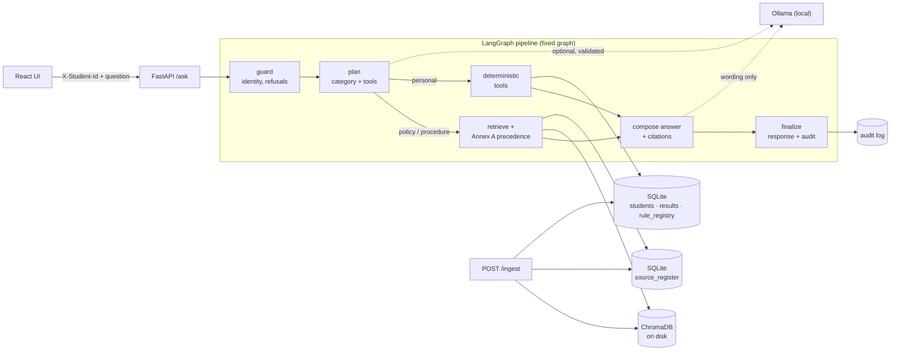

<div align="center">

# 🎓 uniAssist

### An evidence-first assistant for university student services

Answers from **authorised documents** and **authorised student records**.<br/>
Never invents a rule, a number, a citation or a decision.


-2EA44F)

[**Quick start**](#-quick-start) ·
[**How it works**](#-how-it-works) ·
[**API**](#-api) ·
[**Documents & precedence**](#-documents-versions-and-precedence) ·
[**Evaluation**](#-evaluation) ·
[**Limitations**](#-limitations-read-this)

</div>

---

## ✨ What it does

| | |
|---|---|
| 📚 **Cited answers** | Policy and procedure questions return the passage with **document · section · page · version · effective date**. |
| 🧮 **Deterministic decisions** | "Am I eligible…?" is computed by code over SQLite. Thresholds come from a **rule registry** where every rule cites a clause. |
| ⚖️ **Conflict handling** | Versioned or conflicting documents are resolved by the **Source Precedence Policy (Annex A)**, with the reasoning shown. Unresolvable conflicts are **flagged, not guessed**. |
| 🔮 **Upcoming changes** | A circular that is not yet in force is never treated as current, but is mentioned as an upcoming change. |
| 🧠 **Multi-step what-ifs** | "If I pass the supplementary, will I be placement-eligible?" with the assumptions stated. |
| 🔒 **Private by design** | Identity comes only from the `X-Student-Id` header. Other students' data is refused. The LLM is local; nothing leaves the machine. |
| 🧾 **Auditable** | Every response has a `trace_id` and an audit record: sources, tools with inputs and outputs, rules, conflicts, model, tokens, latency. |
| ⚡ **Live ingestion** | `POST /ingest` a new document; the very next question uses it. No restart, no code change. |

## 🚀 Quick start

### 🐳 Docker (API + UI start together)

```bash
docker compose up --build           # or, with prebuilt images:  docker compose pull && docker compose up
```

| Service | URL |
|---|---|
| UI | http://localhost:5173 |
| API + interactive docs | http://localhost:8000/docs |

First boot loads the synthetic students and ingests `corpus/source_register.csv` (about a minute). State persists in `./runtime` (vectors, SQLite, audit log, uploads), so restarts **never re-ingest**.
Prebuilt images: [`dishantsaini55/uniassist-backend`](https://hub.docker.com/r/dishantsaini55/uniassist-backend) · [`dishantsaini55/uniassist-frontend`](https://hub.docker.com/r/dishantsaini55/uniassist-frontend).

<details>
<summary><b>🦙 Using Ollama (optional, runs on the host)</b></summary>

```bash
ollama pull llama3.1:8b                       # or qwen2.5:7b-instruct
LLM_MODE=ollama docker compose up --build     # backend reaches the host at host.docker.internal:11434
# If Ollama listens only on localhost:  OLLAMA_HOST=0.0.0.0 ollama serve
```

`LLM_MODE=mock` (default) needs no model: explanations are deterministic templates. There is **no cloud LLM fallback** anywhere in this code base.

</details>

<details>
<summary><b>💻 Run locally without Docker</b></summary>

```bash
python -m venv .venv && source .venv/bin/activate      # Windows: .venv\Scripts\Activate.ps1
pip install -r requirements.txt                        # tesseract is optional (OCR of scanned pages)
python scripts/bootstrap.py                            # schema + synthetic students + corpus (idempotent)
uvicorn app.api.main:app --port 8000                   # also bootstraps on start unless AUTO_BOOTSTRAP=0
cd frontend && npm install && npm run dev              # http://localhost:5173 (proxies /api to :8000)
```

Configuration lives in `.env.example` (`LLM_MODE`, `LOCAL_LLM_MODEL`, `EMBEDDING_MODEL`, `RETRIEVAL_TOP_K`, thresholds).

</details>

## 🧩 How it works



<details>
<summary><b>🧭 Design decisions (and what we deliberately did not build)</b></summary>

* **A fixed LangGraph, not a supervisor with specialist agents.** Every step is either deterministic (guard, retrieval, precedence, tools, composition) or one validated LLM call (planning, explanation). Autonomous multi-agent behaviour would add nothing here, and a fixed graph is fully auditable. It still branches for real: refuse / clarify / retrieve / tools.
* **The LLM never decides anything authoritative.** It may *choose tools* (validated against the registry, deterministic fallback) and *word an explanation* (every number must already be in the evidence, else the template is used). Calculations, eligibility and lookups are code over SQLite.
* **Rules live in the database, not in code.** `rule_registry` rows are extracted from ingested documents (or added explicitly) and cite `source_doc_id` + `source_section`. A test proves that editing the registry flips a decision.
* **One precedence engine for retrieval and tools** (`rag/precedence.py`), so a retrieved answer and a tool decision can never disagree about which document wins. Retrieval also pulls in *every* source that makes a claim on the same topic, so a FAQ that matches the wording ("65%") cannot hide the circular that overrides it.
* **Embedded ChromaDB persisted to `runtime/chroma`**: one fewer container, restarts never re-ingest. Embeddings: `BAAI/bge-small-en-v1.5`.
* **Section-aware chunking** keeps clause, page and version as metadata, so citations point at the exact clause (fixed-size chunking scored 3.7 % citation accuracy in our comparison).
* **Privacy:** the audit log stores the student id, tool inputs/outputs (required for auditability) and the answer type, **not the question text** (only a short hash). Chroma telemetry is off.
* **Not built:** a cloud-LLM fallback, user authentication (identity is whatever trusted caller sets `X-Student-Id`, as the contract specifies), re-ranking models.

</details>

## 🔌 API

| Endpoint | Purpose |
|---|---|
| `POST /ask` | `{"question", "as_of_date"?}` + header `X-Student-Id` (optional for general questions) |
| `POST /ingest` | Multipart: `file` + `metadata` (Annex B fields as JSON or form fields) → `doc_id`, `chunks_indexed`, `status` |
| `GET /health` | Status of API, SQLite, vector store, LLM |
| `GET /audit/{trace_id}` | Full audit record of one response |
| `GET /sources` | Source Register (all ingested documents) |
| `POST /admin/students` | Test-student loader (CSV files in the Annex C schema); CLI twin: `scripts/load_students.py` |

Answer types: `retrieved_fact` · `calculated` · `not_found` · `clarification_needed` · `refused` · `conflict_flagged`

<details open>
<summary><b>📮 Sample requests (real output, trimmed)</b></summary>

```bash
# 1. Policy question: the 80% circular supersedes the 75% regulation clause; the 65% FAQ is ignored
curl -s -X POST localhost:8000/ask -H 'Content-Type: application/json' \
  -d '{"question":"What is the minimum attendance required to appear for end-semester exams?","as_of_date":"2026-10-06"}'
# -> retrieved_fact: "...the minimum attendance required ... shall be 80% in each course.
#    (Source: Circular ACAD/2026/08, section 1.1, page 1, version 1.0, effective 2026-08-01.)"
#    explanation: "Explicit supersession (step 2): FIX-CIR-2026-08 supersedes FIX-REG-2024 clause 7.2 ...
#                  Authority (step 3): FIX-FAQ-2026 (level 4) says 65, but FIX-CIR-2026-08 (level 2) prevails."

# 2. Personal eligibility: computed by a tool, cited to the clause
curl -s -X POST localhost:8000/ask -H 'Content-Type: application/json' -H 'X-Student-Id: S1001' \
  -d '{"question":"Am I eligible to appear in the exam for Data Structures?","as_of_date":"2026-10-06"}'
# -> calculated: "You are not eligible ..." (attendance 75.0% vs required 80%, 2 classes short)
#    The same question with "as_of_date":"2026-05-01" is ELIGIBLE under the 75% regulation.

# 3. What-if with assumptions
curl -s -X POST localhost:8000/ask -H 'Content-Type: application/json' -H 'X-Student-Id: S1003' \
  -d '{"question":"I failed Data Structures. If I pass the supplementary, will I be eligible for placement?"}'

# 4. Not answerable / another student's data
curl -s -X POST localhost:8000/ask -H 'Content-Type: application/json' -d '{"question":"What is the scholarship for studying in Antarctica?"}'
#    -> not_found: "I could not find this information in the authorised university sources."
curl -s -X POST localhost:8000/ask -H 'Content-Type: application/json' -H 'X-Student-Id: S1001' -d '{"question":"What is the attendance of S1002?"}'
#    -> refused (identity comes only from the header; no tool is called)

# 5. Live ingestion: used by the very next question, no restart
curl -s -X POST localhost:8000/ingest -F file=@circular.pdf -F 'metadata={"doc_id":"ACAD-2026-11","title":"Circular ACAD/2026/11",
  "issuer":"Office of the Dean (Academics)","authority_level":2,"doc_type":"circular","version":"1.0","effective_from":"2026-10-05",
  "supersedes":"FIX-CIR-2026-08#1.1","scope_programmes":"ALL","scope_batches":"ALL","provenance":"https://...","retrieved_on":"2026-10-06","synthetic":"N"}'
# -> {"doc_id":"ACAD-2026-11","chunks_indexed":2,"status":"ingested","rules_extracted":1,"rules":[{"parameter":"min_attendance_pct","operator":">=","value":"85",...}]}

# 6. Audit trail, sources, health
curl -s localhost:8000/audit/<trace_id>   curl -s localhost:8000/sources   curl -s localhost:8000/health
```

Six complete sample audit records (request, response and audit record) are in [`docs/sample_audit/`](docs/sample_audit/).

</details>

## 📑 Documents, versions and precedence

* **Source Register** = SQLite table `source_register` (Annex B fields) seeded from [`corpus/source_register.csv`](corpus/source_register.csv). `effective_from` and `authority_level` are required; `effective_to`, `supersedes` (`DOC-ID` or `DOC-ID#7.2`, `;`-separated), `scope_programmes` and `scope_batches` (`ALL`, `2023`, `2023+`, `2021-2023`) are optional.
* **Parsing:** PDF text by page, tables kept as rows, clause numbers (`7.2`) detected, **OCR fallback for scanned pages**, line-wrap repair. Instruction-like sentences inside documents are **removed and flagged**: documents are data, not instructions.
* **Annex A precedence** ([`rag/precedence.py`](rag/precedence.py)):

  | Step | Rule |
  |---|---|
  | 1 | **Applicability**: date window and programme/batch scope. Not-yet-effective documents are excluded and reported as *upcoming changes*. |
  | 2 | **Explicit supersession** by a level 1-2 document. |
  | 3 | **Authority**: higher level wins. |
  | 4 | **Recency**: later `effective_from` wins at equal authority. |
  | 5 | **Unresolved** → `conflict_flagged`, both sources cited. |

  Level 5 (unofficial) content is informational only. Authority and recency apply only between sources making *different claims on the same topic*; complementary passages are all kept.
* **How a rule enters the registry:** on ingest, deterministic extractors find comparable claims (minimum attendance, pass mark, placement CGPA and backlog limits, supplementary eligibility) and write `rule_registry` rows citing document and clause; admins can also pass explicit `rules` in the metadata. **When a new circular changes a rule**, ingest it with `supersedes`/`effective_from`: it adds a competing row, the engine picks the winner for each `as_of_date`, and old rows are kept so past dates still answer correctly.

> [!IMPORTANT]
> **Real documents are your job.** The repo ships **synthetic fixtures** (`corpus/fixtures/`) so conflicts, supersession, upcoming changes, scope, tables, OCR and prompt-injection are testable. They are not official. Add your university's public documents (the guide wants ≥ 3, at most 2 synthetic) as described in [`corpus/README.md`](corpus/README.md), then run `python scripts/ingest.py --corpus`.

## 🧪 Student data

36 synthetic students in the fixed Annex C schema (2 programmes, 2 batches, 8 courses) with deliberate edge cases (exactly at a threshold, one class below, failed just under the pass mark, absent, detained, multiple backlogs, CGPA at the cut-off). See [`docs/data_card.md`](docs/data_card.md).

```bash
python scripts/generate_students.py --out data/students    # deterministic; CSVs in the Annex C schema
python scripts/validate_data.py                           # schema + logical constraints, prints violations
python scripts/load_students.py --dir test_students/      # loader for students/courses/attendance/results CSVs
```

## 📊 Evaluation

```bash
python scripts/evaluate.py     # writes evaluation/report.md and results.json
pytest                         # 87 tests: unit, API contract, live ingestion, authorisation, data kit
pytest -m slow                 # re-runs the evaluation as a quality gate (needs RAM for a second model load)
```

59 questions · exact/substring matching · section-level citation check · literal tool-output comparison · **no LLM judge**.

| Metric (config A, mock LLM, synthetic corpus) | Result |
|---|---|
| Answer correctness | **98.3 %** (59) |
| Citation accuracy | **96.3 %** (27) |
| Abstention accuracy | **100 %** (59) |
| Tool-result correctness | **100 %** (29) |
| Retrieval hit rate (top-5) | **100 %** (22) |
| Latency p50 / p95 | 25-60 ms / 55-110 ms (in-process, no LLM) |

| Config | Description | Correct | Citations |
|---|---|---|---|
| **A** ✅ | bge-small, section chunks, k=5 | **98.3 %** | **96.3 %** |
| B | all-MiniLM-L6-v2, section chunks | 89.8 % | 77.8 % |
| C | bge-small, fixed 400-char chunks | 74.6 % | 3.7 % |
| D | bge-small, section chunks, k=2 | 96.6 % | 96.3 % |

> [!WARNING]
> These numbers are optimistic. 39 of the 59 questions were written alongside the system. On the 20 paraphrased questions added later, **first-run** scores were **60 %** and **80 %**; the failures exposed real bugs that were then fixed. Read [`evaluation/README.md`](evaluation/README.md) before quoting any figure.

## ⚠️ Limitations (read this)

* **Identity is trusted:** `X-Student-Id` is taken as the logged-in student; there is no authentication layer. `/ingest` and `/admin/students` are unauthenticated by design (judges call them directly).
* **The corpus is synthetic until you add real documents.** Extraction patterns were developed against the fixtures; unusual phrasing (spelled-out numbers like "eighty percent", tables of percentages) may not yield a rule: pass explicit `rules` in the ingest metadata.
* **The live Ollama path is untested end to end** (no Ollama on the development machine). Planning and explanation are exercised with a stubbed model: validation, fallback, number-grounding. Try `LLM_MODE=ollama` and check `/audit/{trace_id}` for `llm_errors`. Local 7-8B models can produce invalid JSON; that is handled by retry plus deterministic fallback.
* **Abstention thresholds are tuned on a small corpus** (`MIN_SIMILARITY`, `STRONG_SIMILARITY`, `MIN_TERM_COVERAGE`); re-check them for a new corpus or model. Known miss: "What happens to a student who is below the attendance requirement?" retrieves the supplementary clause instead of the detention clause.
* **What-if modelling is limited:** a supplementary pass clears exactly one backlog and leaves CGPA unchanged (stated in `assumptions`). Three forms are understood: supplementary → placement, extra classes → exam eligibility, hypothetical CGPA → placement.
* **Course resolution** matches codes, full names and initials ("OS", "DS"); other abbreviations ask for clarification.
* **Tool coverage** is five rules: attendance, pass mark, supplementary eligibility, placement CGPA and backlogs. Everything else is answered as cited text, not computed.
* Scanned-page OCR needs `tesseract` (included in the Docker image); without it a scanned PDF is rejected with a clear error.

## 🗂️ Repository layout

```
app/          FastAPI app, config, SQLite access, registry, loader, validation, bootstrap
graph/        LangGraph pipeline, planner, answer composition
rag/          PDF/OCR/sections/chunks, claims, precedence (Annex A), retriever, vector store, embeddings
ingestion/    live ingestion service + corpus bootstrap
tools/        deterministic tools (records, rules, eligibility, what-ifs) + audited ToolRunner
llm/          Ollama client, number-grounding, tool-plan validation
data/         synthetic student CSVs, seed identities, prompts
corpus/       fixture documents + source_register.csv (Annex B)
evaluation/   questions.json, run_eval.py, report.md, results.json, README.md
scripts/      bootstrap, ingest, load_students, validate_data, generate_students(_llm), build_fixtures, evaluate
tests/        pytest suite          docs/   data card, prompts, AI usage, templates, sample audit records
frontend/     React + Vite UI
```

## ✅ Deliverables status

| Deliverable | Status |
|---|---|
| README, architecture, setup, curl samples, assumptions, limitations | ✅ |
| `docker compose up` starts API, UI and stores | ✅ built and smoke-tested; images on Docker Hub |
| Source Register (CSV) and documents | ✅ fixtures · ⚠️ **add the real documents** |
| Rule registry in SQLite, every rule linked to a clause | ✅ |
| Synthetic data kit: prompts, generator, validation, data card | ✅ · ⚠️ fill in the original seed prompt/model in `docs/prompts.md` |
| Evaluation set and report | ✅ |
| Three sample audit records | ✅ (six) |
| AI-usage disclosure | ✅ [`docs/ai_usage.md`](docs/ai_usage.md) |
| Team contribution statement | ⚠️ template [`docs/team_contribution.md`](docs/team_contribution.md): team to complete |
| Signed declarations of original work | ⚠️ template [`docs/declaration_of_original_work.md`](docs/declaration_of_original_work.md): each member signs |
| Git repo tagged final | ⚠️ tag it: `git tag -a final -m final` |

---

<div align="center"><sub>Cited · Deterministic · Auditable</sub></div>
